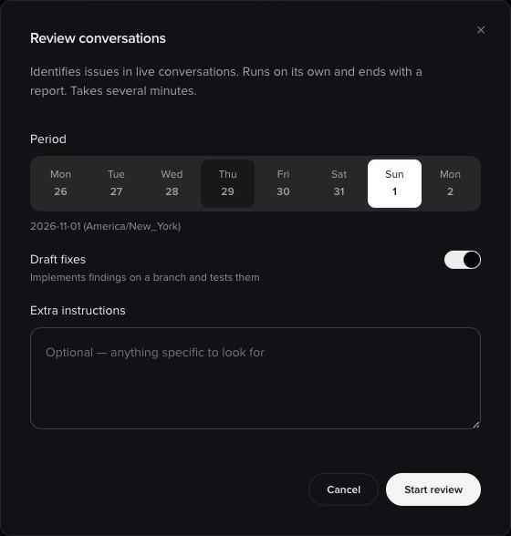
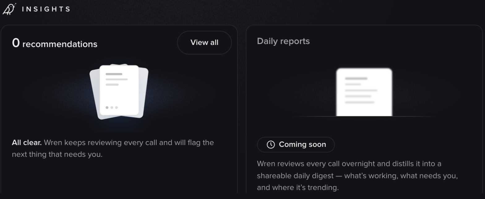
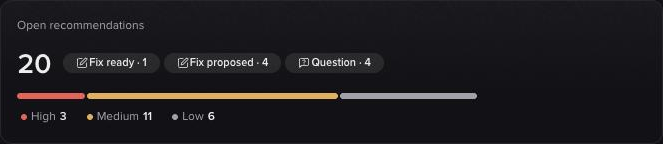
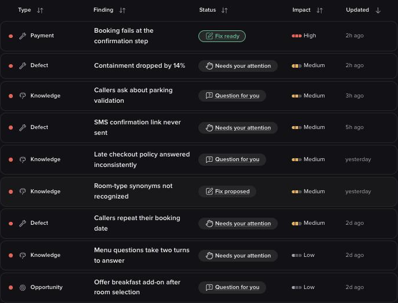
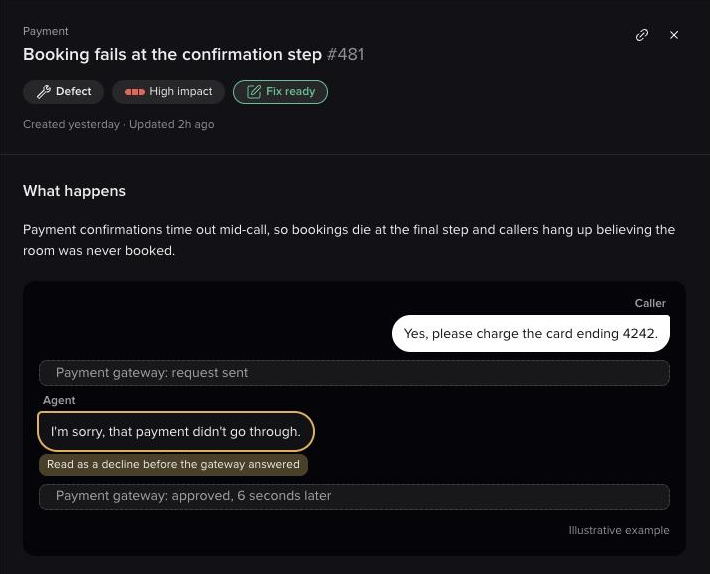
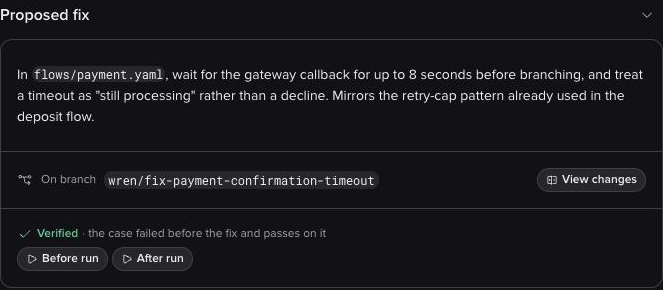

Analysis answers the questions you think to ask. Automated review is for the ones you don't. Wren reads a stretch of recent calls on its own, works out what's going wrong, and brings you a report.

## Review a stretch of calls

Start a review from the **+** menu in the composer: under **Routines**, choose **Review conversations**. Wren asks for:

| Option | What it does |
|---|---|
| **Period** | The stretch of days to review. Pick a single day or a range from today and the seven days before it. |
| **Draft fixes** | Wren implements what it finds on a Branch and tests the fix, instead of only reporting it. |
| **Extra instructions** | Optional. Anything specific you want it to look for. |

Every review builds on past reviews, so it doesn't re-report what you've already seen.

<Frame caption="Setting up a review before it runs">
  
</Frame>

The review then runs on its own, without stopping to ask questions, and ends with a report. It reads real production calls, so expect it to take several minutes.

<Note>
Reviews always run hands-off, regardless of whether you're in Interactive or Auto mode. That's why the options above are set up front.
</Note>

### What a review produces

Wren works through your project area by area (the caller journey, the knowledge base, and everything else), and for each candidate problem it checks itself before reporting: it verifies the issue is real, and sizes how often it actually happens across the period.

Each finding comes with:

- **What's wrong**, and which part of the project it sits in
- **A type:** a defect, a knowledge gap, or an opportunity
- **A severity:** high, medium, or low
- **Evidence:** how many of the sampled calls were affected, with example conversations you can click straight into

Where a problem can't be reliably sized, Wren says so rather than inventing a percentage.

With **Draft fixes** enabled, Wren goes a step further on what it finds: it reproduces the problem against a test build, writes a failing test, makes the smallest change that fixes it, and re-runs to confirm. Each fix lands on its own Branch.

<Warning>
**Wren never merges or publishes a fix.** Reviews and drafted fixes always stop at a Branch. Nothing reaches Live without you approving and publishing it yourself.
</Warning>

Sometimes the cause sits outside your project: telephony, an upstream service, or the platform itself. Wren reports those too, and says plainly that it can't fix them from here.

<Note>
Starting a review by hand is rolling out gradually. If you don't see **Review conversations** in the **+** menu, ask your PolyAI contact whether it's enabled for your account.
</Note>

## Continuous review

Running a review by hand is one way in. Wren also reviews your calls on a schedule, so problems find you instead of the other way around. What it finds surfaces on the Wren home screen, under **Insights**.

<Frame caption="The Insights zone on the Wren home screen">
  
</Frame>

### Scheduled reviews

New projects you create in Dialog Studio, including duplicated and imported ones, get a nightly review automatically. It runs at a set time between midnight and 6 AM in your region's time zone, and covers the previous full day of calls on Live.

A night is skipped when the project had fewer than 30 Live conversations in the previous 24 hours, so quiet and test projects don't fill up with noise.

To change or turn off a project's schedule, contact your PolyAI representative.

### Recommendations

Rather than a report you read once, findings become a **standing list** on your project: an inbox of things that need your attention, each one persisting until it's resolved or dismissed. Open findings are summarized by what they need from you and how much impact they have.

<Frame caption="Open findings, grouped by what they need from you and their impact">
  
</Frame>

Each finding shows its status, its impact, its type (**Defect**, **Knowledge**, or **Opportunity**), and when it was last updated. Impact combines how severe the problem is with how often it happens, so a rare but severe problem can rank as medium.

<Frame caption="The findings list">
  
</Frame>

Open one and you get the full picture:

- **What happens:** the problem, and which part of the project it relates to
- **How often:** how many conversations were affected, with example conversations you can open
- **Why it happens:** the cause, where Wren traced it
- **Latest updates:** what Wren and your team have done on the finding since it was opened

A closed finding shows who resolved or dismissed it, and why, at the top.

<Frame caption="A single finding, with its evidence">
  
</Frame>

Every open finding carries a status that says what it needs from you: *Needs your attention*, *Question for you*, *Answered*, *Fix proposed*, or *Fix ready*. Closed findings are *Resolved*, *Dismissed*, or *Archived*. A finding nobody acts on for 14 days is archived automatically; you can still find it under **Closed** and reopen it. From a finding you can:

- **Approve and publish** a fix Wren has drafted and verified
- **View the changes** before deciding
- **Refine it in chat** if the fix is close but not right
- **Answer a question** Wren has about your business rules, right in the finding, when it needs one to proceed
- **Dismiss it** as working as intended, already resolved, not worth addressing, or a mistake by Wren, with the reason feeding back into what gets surfaced next
- **Revert** a change after the fact if it doesn't hold up
- **Reopen** a closed finding

Where Wren has drafted a fix, it shows you the change it proposes, the Branch it sits on, and proof that it works: the test case failed before the fix and passes on the Branch.

<Frame caption="A drafted fix, verified against the test suite before you approve it">
  
</Frame>

Because findings persist across reviews, Wren builds on what it already knows about your agent instead of re-reporting the same issue every time.

## Related pages

<CardGroup cols={3}>
  <Card title="Analyze conversations" icon="chart-line" href="/wren/analyze">
    Ask your own questions about real calls.
  </Card>
  <Card title="Conversation review" icon="magnifying-glass" href="/analytics/conversations/review">
    Read the calls behind a finding.
  </Card>
  <Card title="Simulation tests" icon="flask" href="/testing/simulation-tests">
    Where verified fixes leave their test coverage.
  </Card>
</CardGroup>
